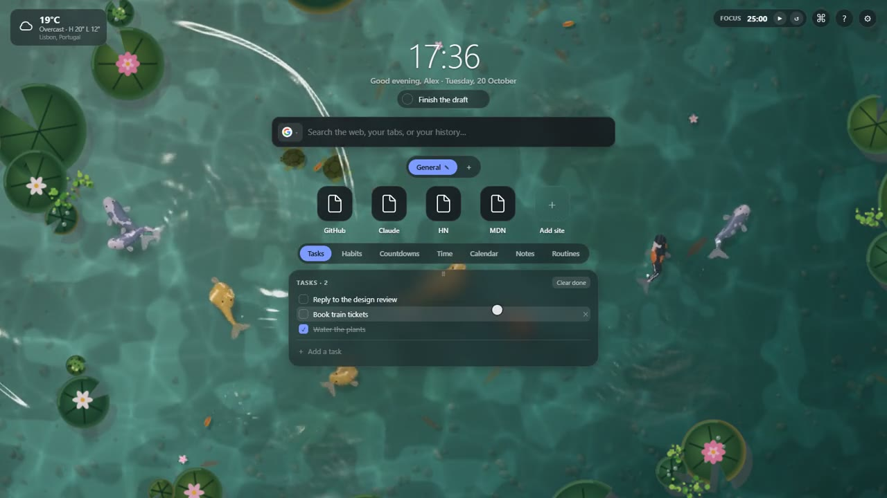

# My New Tab

A calm new tab page for Chrome. It has a command palette that also does sums,
quick links, weather, your calendar, tasks, habits, notes, and a pause in front
of the sites that eat your day. A koi pond can swim behind it all.

- No account, no tracking, no build step.
- No runtime dependencies.
- Your data stays on your device.

[](docs/demo.mp4)

*Click the picture to watch a 35 second demo: the koi pond, the command palette and the card deck.*

## Try it in one minute

1. Get this folder: clone the repo or download it as a zip and unzip it.
2. Open `chrome://extensions` (or `brave://extensions`).
3. Turn on **Developer mode** (top right).
4. Click **Load unpacked** and pick this folder.
5. Open a new tab.

You do not need Node or `npm install` to use it. Chrome loads the files as
they are.

## Things to try first

| Do this | What happens |
| --- | --- |
| Press `?` | A sheet lists everything the page can do. |
| Press `Ctrl`/`Cmd` + `K` | The command palette opens. |
| Type `20% of 60` in the palette | You get `12`. `Enter` copies it. |
| Type `10 km in miles` | You get `6.2137119 mi`. |
| Type a plain thought, like `call the plumber` | The palette offers to save it as a task or today's focus. |
| Press `W` | The deck shows the next card. |
| Drag a card by the grip on its top edge | It moves to the left or right rail. |
| Press `,` | Settings open. |
| Settings → Appearance → **Animated** | A koi pond moves behind the page. Click the water to splash it. |
| Add `youtube.com` in the **Time** card | A short pause waits in front of that site. |

## What is inside

**Find and go**
- A command palette for your links, routines, open tabs, bookmarks, history
  and actions. Rows you pick often rise to the top.
- Instant answers: sums, percentages and unit conversions. No `eval()` is used.
- A search bar. Type `g:`, `ch:` or `cl:` to pick an engine, or add your own
  in **Settings → Search**.
- Quick links in groups. Drag to reorder. Press `1`–`9` to open one.
- Routines: a named set of sites that opens with one click.

**Your day**
- A clock, a greeting and one daily focus that clears at midnight.
- Tasks, habits (a dot per day), countdowns, notes and a focus timer.
- Weather from Open-Meteo, and a calendar from one secret `.ics` address.

**Time you lose**
- Name a site. Each site can **pause** you, ask you to **type a sentence**, or
  stay **blocked**.
- Set a daily limit of visits or minutes. Past a minute limit, the tab shows a
  time-out page with a real quote and its source.
- Turn on **In every tab** to also stop sites you type in the address bar.
- Turn on **Count every site** to see time and visits per site.

**Make it yours**
- Dark, light or match the system, with an accent colour you pick.
- Backgrounds: a photo, a gradient, a colour, your own image, or the koi pond.
- Every card can be turned off. **Settings → Data** saves a backup file and
  reads it back.

### Keyboard shortcuts

| Keys | Action |
| --- | --- |
| `Ctrl`/`Cmd` + `K` | Command palette |
| `/` | Jump to the search bar |
| `?` | What this tab does |
| `W` | Show the next card |
| `1`–`9` | Open a quick link (`Shift` for a new tab) |
| `Shift` + `←`/`→` | Switch link group |
| `B` | New background photo |
| `N` | Jump to notes |
| `T` | Add a task |
| `,` | Open settings |

## Privacy and permissions

Nothing leaves your device except these calls:

| Host | Why |
| --- | --- |
| `picsum.photos` | Background photos |
| `open-meteo.com` | Weather and city search |
| `calendar.google.com` | Only the one calendar address you paste |

Site icons come from Chrome's own cache, not from a third party.

Chrome asks for no scary permission at install time. Some features need more.
The page asks only when you turn that feature on, and it works without them.

| Permission | When |
| --- | --- |
| `tabs`, `bookmarks`, `history`, `topSites` | Optional. Palette search, saving open tabs as a routine, counting time. |
| `webNavigation` | Optional. Only for **In every tab**. Chrome says it can "read your browsing history". |

The permissions Chrome grants at install are `storage`, `unlimitedStorage`,
`favicon`, `alarms`, `idle` and `tabGroups`. None of them shows an install
warning.

## If something looks wrong

- **The pond is plain, without moving water.** Your browser has no usable
  WebGL 2. The page draws a simpler 2D pond instead.
- **The pond does not move.** Reduced motion is on in your system. You get one
  still frame.
- **The window is narrow and the side rails are gone.** Rails need about
  1440px. Your choice comes back when the window is wide enough.
- **A watched site does not stop in other tabs.** Turn on **In every tab** in
  **Settings → Time**, and allow the permissions it asks for.

## Work on it

There is no build step. Edit a file, then reload the extension at
`chrome://extensions`.

```bash
npm install    # jsdom, only for the page tests
npm test       # unit tests and a jsdom run of the whole page
npm run check  # ids, CSS classes, imports and manifest paths all resolve
```

`npm test` also works without `npm install`. The page tests skip themselves
when jsdom is missing.

[AGENTS.md](AGENTS.md) has the file layout and the rules for code, for people
and for coding agents. It also shows how to add a widget or a scene.

## License

MIT. See [LICENSE](LICENSE).
